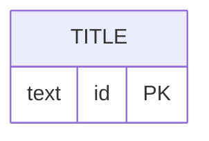

# [BingeBound] — Data & API Design

> **When:** Week 3 (Sections 0–2), Week 4 (Sections 3–4) · **Owner:** Architecture Lead · **Done when:** every item in the SVC Self-Check at the end is true.
>
> **Version:** 1.1
>
> **Approved on:** ___ **by:** Architecture Lead Austin Hammond · Product Owner Lilah Leal · Delivery Lead Ben Anderson
>
> **Filled-in Example:** `docs/examples/data-api-design-example.md`

This document turns the Spec's nouns into data and its user actions into endpoints. If the built app and this document disagree, this document wins until it's deliberately changed. Unresolved questions go in the Spec's Open Questions.

Version 1.1 removes the User entity and login. Spec constitution item 1 and R9 forbid a login wall in v1. The course build stores titles on the device.

---

## 0. Database & Storage

**Database:** None in the course test build. Titles live in the browser (local storage), one list per device. A later System Implementation may use PostgreSQL, but v1 does not.

**Build option:** Simulated data layer. One JSON file of sample titles in `data/`, and functions in `data.js` that read and write the device list. No Supabase Auth, no user picker, no passwords.

**We store:** The titles on this device: title text, type, origin, status, optional note, rating, episode progress for a series, and the time it was added (so the list can sort newest first).

**We do NOT store:** Users, passwords, accounts, streaming catalog data, or anything fetched from Netflix, TMDB, or another API.

**Sensitive fields:** Title text, status, notes, and rating are personal. They stay on the device. Sample JSON is synthetic and labeled. Clearing site data clears the list. That matches Spec R9 and R10-style device storage.

---

## 1. Entities

**Key:** `PK` = identifies each row · `FK → Entity` = points to another entity's PK · `Unique` = no two rows can share this value.

There is one entity. There is no User.

**Entity: Title**

One movie or series on this device's list. The same title text may appear more than once.

| Field | Type | Key | Required? | Req ID |
|-------|------|-----|-----------|--------|
| id | text | PK | Yes | R1 |
| title | text | — | Yes; non-blank | R2, R6 |
| type | enum: `Movie`, `Series` | — | Yes | R2, R14 |
| origin | enum: `U.S.`, `International` | — | Yes | R2, R4, R15 |
| status | enum: `Plan to Watch`, `Watching`, `Completed`, `Dropped`, `On Hold` | — | Yes; default `Plan to Watch` | R3, R4 |
| note | text | — | No | R13 |
| rating | integer 0–10 | — | No | R13 |
| episode_current | integer | — | No; only when type is Series | R14 |
| episode_total | integer | — | No; only when type is Series | R14 |
| created_at | text (ISO date-time) | — | Yes | R1 |

**Foreign-key delete rule:** None. There is no parent entity. Deleting a title removes only that title (R11).

---

## 2. Entity Relationship Diagram (ERD)

One entity. No relationship.

---

## 3. Normalization Check

- [x] **1NF** — every field holds one value.
- [x] **2NF** — every field depends on the whole primary key.
- [x] **3NF** — no field depends on another non-key field.

**Intentional exceptions:** None. `episode_current` and `episode_total` are empty when type is Movie. They are not a second table because a title has at most one progress pair.

---

## 4. API Endpoints

These are the shapes `data.js` must return. There is no login. “Anyone” means the person using this browser.

| Req ID | Method | Path | Request | Success response | Errors | Who can call it |
|--------|--------|------|---------|------------------|--------|-----------------|
| R1, R4, R5, R7 | GET | /v1/titles | Optional search text, type, origin, status | 200 `{ items: [Title, ...] }` newest first. No match → 200 `{ items: [] }`. The screen, not this endpoint, shows “No titles match. Clear filters.” | 400 if a filter value is not in the enum | Anyone |
| R1 | GET | /v1/titles/{id} | Title id in path | 200 the Title | 404 `{ "error": "Title not found" }` | Anyone |
| R8 | GET | /v1/demo/titles | — | 200 `{ is_demo: true, label: "Sample titles. Not your personal list.", items: [Title, ...] }` | — | Anyone |
| R2, R6 | POST | /v1/titles | `{ title, type, origin, status, note?, rating?, episode_current?, episode_total? }` | 201 the saved Title, including `id` and `created_at`. Status defaults to `Plan to Watch` if omitted. | 400 `{ "error": "Type a title to save it." }` if title is blank. 400 if type, origin, or status is not in the enum. | Anyone |
| R3, R13, R14 | PATCH | /v1/titles/{id} | Any of status, note, rating, episode_current, episode_total | 200 the updated Title | 400 if a value is out of range. 404 if not found. | Anyone |
| R11 | DELETE | /v1/titles/{id} | Title id in path | 204 | 404 if not found | Anyone |

No `POST /v1/login`, `GET /v1/me`, or `POST /v1/logout`. Those would violate Spec R9.

**Simulated:** R9 is simulated as “no auth check.” Storage is the browser, not PostgreSQL. Mark both in the Week 8 Build Notes.

---

## SVC Self-Check

- [x] **Simple** — one noun, Title. Paths are nouns.
- [x] **Valuable** — every field has a requirement ID. Login fields were cut because no requirement needs them.
- [x] **Complete** — storage matches the device-only decision. Every P1 data requirement has a field and an endpoint. No FK to invent. ERD is one entity. Normalization is done. No endpoint requires a login.
